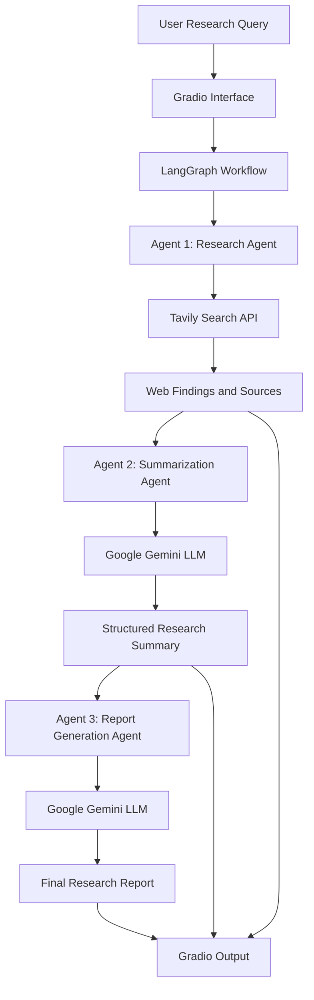

# 🔎 IntelliResearch – Multi-Agent AI Research Assistant

An intelligent, multi-agent research assistant that automates web research, evidence summarization, and structured report generation using **LangGraph, Google Gemini, Tavily Search API, and Gradio**.

IntelliResearch transforms a simple research query into a structured research report by coordinating specialized AI agents through a sequential workflow.

---

## 🚀 Project Overview

Researching a topic manually often requires searching multiple websites, analyzing large amounts of information, identifying key insights, and organizing findings into a meaningful report.

IntelliResearch simplifies this process through a multi-agent architecture.

Users enter a research topic, and the system:

- Searches the web for relevant information.
- Collects research findings and source references.
- Uses an LLM to summarize and analyze the collected evidence.
- Generates a structured research report.
- Displays the summary, report, and source links through an interactive interface.

## 🏗️ System Architecture



### 🤖 Multi-Agent Workflow

**Agent 1 – Research Agent**
- Uses Tavily Search API to search the web.
- Retrieves relevant research results.
- Collects titles, URLs, content, and relevance scores.
- Passes the findings to the next agent.

**Agent 2 – Summarization Agent**
- Uses Google Gemini to analyze research evidence.
- Identifies important findings and insights.
- Generates an executive summary.
- Highlights limitations and unanswered questions.
- Maintains source references.

**Agent 3 – Report Generation Agent**
- Uses Google Gemini to generate a structured research report.
- Organizes findings into meaningful sections.
- Produces a detailed Markdown report.
- Includes source references and supporting links.

**Workflow Orchestration – LangGraph**
- Manages the shared workflow state.
- Coordinates communication between agents.
- Executes agents sequentially.
- Transfers outputs from one agent to the next.

---

## 🛠️ Tech Stack

| Technology | Purpose |
|---|---|
| Python | Core programming language |
| LangGraph | Multi-agent workflow orchestration |
| LangChain | LLM integration and prompt management |
| Google Gemini | Summarization and report generation |
| Tavily Search API | Web research and information retrieval |
| Gradio | Interactive user interface |
| Python-dotenv | Environment variable management |

---

## 📂 Project Structure

```text
IntelliResearch/
│
├── agents/
│   ├── __init__.py
│   ├── research_agent.py
│   ├── summarizer_agent.py
│   └── report_agent.py
│
├── config/
│   ├── __init__.py
│   └── settings.py
│
├── utils/
│   ├── __init__.py
│   └── helpers.py
│
├── workflow/
│   ├── __init__.py
│   └── graph.py
│
├── tests/
│   └── ...
│
├── app.py
├── requirements.txt
├── .env.example
├── .gitignore
└── README.md
```

---

## ⚙️ Installation and Setup

### 1. Clone the Repository

```bash
git clone https://github.com/YOUR_USERNAME/IntelliResearch.git
cd IntelliResearch
```

### 2. Create a Virtual Environment

```bash
python -m venv venv
```

Activate the environment:

**Windows:**
```powershell
venv\Scripts\activate
```

**Linux / macOS:**
```bash
source venv/bin/activate
```

### 3. Install Dependencies

```bash
pip install -r requirements.txt
```

### 4. Configure API Keys

Create a `.env` file in the project root directory.

```env
GOOGLE_API_KEY=your_gemini_api_key
TAVILY_API_KEY=your_tavily_api_key

GEMINI_MODEL=gemini-3.5-flash
MAX_SEARCH_RESULTS=5
```

Obtain your API keys:

- Google Gemini: https://aistudio.google.com/
- Tavily: https://tavily.com/

**Important:** Never upload your `.env` file or expose API keys publicly. Add `.env` and `venv/` to `.gitignore`.

### 5. Run the Application

```bash
python app.py
```

Open your browser and visit:

```text
http://127.0.0.1:7860
```

---

## 🖥️ Application Features

### Research Input
Enter any research topic through the Gradio interface.

### Final Research Report
View the AI-generated structured research report.

### Research Summary
Explore the executive summary, key findings, important insights, limitations, and unanswered questions.

### Sources
Access the original web sources used during research.

---

## 🔄 Workflow Execution

The complete workflow follows:

```text
User Query
    ↓
Tavily Web Search
    ↓
Research Findings
    ↓
Gemini Summarization
    ↓
Structured Summary
    ↓
Gemini Report Generation
    ↓
Final Research Report
    ↓
Gradio Interface
```

Each agent performs a specialized task, while LangGraph manages the overall execution and shared state.

---

## 🔐 Environment Variables

| Variable | Description |
|---|---|
| GOOGLE_API_KEY | Google Gemini API key |
| TAVILY_API_KEY | Tavily Search API key |
| GEMINI_MODEL | Gemini model identifier |
| MAX_SEARCH_RESULTS | Maximum number of web results |

---

## 🎯 Key Learning Outcomes

Through this project, I explored and implemented:

- Multi-agent AI application development.
- LangGraph state-based workflow orchestration.
- LLM integration using LangChain.
- Prompt engineering and evidence-based summarization.
- Web search and information retrieval.
- Sequential agent communication.
- API integration and environment configuration.
- Interactive AI application development using Gradio.

---

## 🔮 Future Enhancements

- Integrate Ollama for local LLM inference.
- Implement automatic fallback between cloud and local LLM providers.
- Add vector database integration for persistent research knowledge.
- Implement Retrieval-Augmented Generation (RAG).
- Add PDF and document export functionality.
- Introduce source credibility evaluation and fact verification.
- Support parallel research agents for multiple domains.

---

## ⚠️ Limitations

- Research quality depends on the relevance and reliability of retrieved web sources.
- Gemini API availability, quotas, and rate limits can affect execution.
- Generated information should be verified against original sources.
- The current workflow executes agents sequentially.

---

## 👩‍💻 Author

**Nandhini S S**

---


